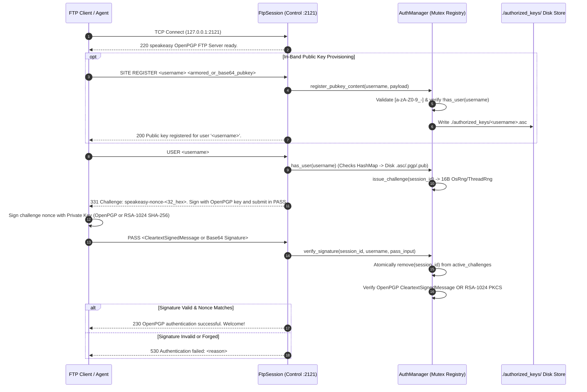
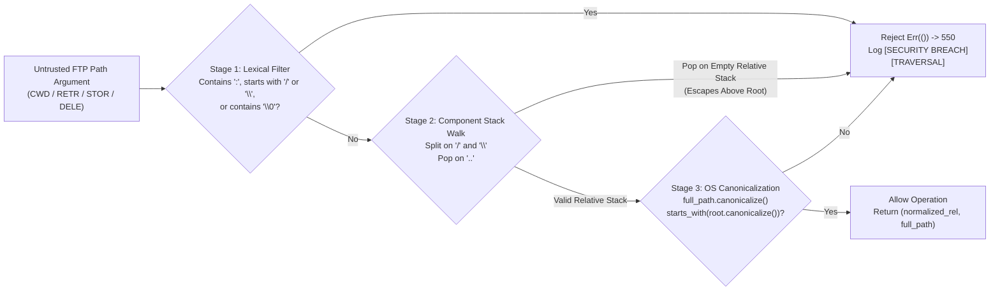

# Mahajani Architecture & Cryptographic Specification

This document details how **Mahajani** operates internally: its asymmetric challenge-response authentication protocol (inspired by historical Indian **Hundi** credit vouchers), dual-mode OpenPGP / RSA-1024 signature verification engine, in-band public-key enrollment rules, virtual root path-traversal Intrusion Detection System (IDS), bounded socket concurrency model, and threat posture.

---

## 1. Design Philosophy: From Mercantilist Hundis to Zero-Password FTP

In traditional Mughal and Marwari banking networks, a client never carried raw specie across hostile territory, nor did distant correspondent bankers rely on static, easily forged passwords. Instead, a banker (*Sarraf*) issued a **Hundi** drafted in the vowel-stripped **Mahajani** script containing an embedded cryptographic checksum. Only a counterparty possessing the corresponding key rules could validate the instrument and release the line of credit on demand (*Darshani Hundi*).

Standard RFC 959 FTP violates this principle by transmitting static passwords in cleartext (`PASS <password>`). **Mahajani** retrofits the RFC 959 control state machine into a **Zero-Password Asymmetric Challenge-Response Protocol**:
1. **Zero Static Secrets on the Server:** The server stores only public keys (`SignedPublicKey` or `VerifyingKey<Sha256>`) inside `./authorized_keys/` and in-memory `Mutex<HashMap<String, AuthorizedKey>>`. Compromise of the server's `authorized_keys` directory yields zero reusable client credentials.
2. **Per-Session Ephemeral Nonces:** Every `USER <username>` command generates a fresh 128-bit CSPRNG challenge (`speakeasy-nonce-<32_hex_chars>`) keyed to the connection's randomized `session_id` (`sess_<u64_hex>`).
3. **Atomic Single-Use Nonce Consumption:** The first call to `AuthManager::verify_signature()` unconditionally removes the session's challenge from `active_challenges` *before* evaluating the signature. A captured `PASS` signature can never be replayed, and a failed signature forces the client to request a new `USER` challenge.

---

## 2. Cryptographic Challenge-Response Protocol (`src/auth.rs` & `src/keygen.rs`)

### 2.1 Dual-Mode Public Key Representation (`AuthorizedKey`)
`AuthManager` supports two cryptographic key representations under `AuthorizedKey`:
- **`AuthorizedKey::OpenPgp(SignedPublicKey)`:** Parsed via the pure-Rust `pgp` crate (`v0.21.0`, RFC 4880 / RFC 9580). Loaded from `.asc`, `.pgp`, or `.pub` files in `./authorized_keys/` or registered dynamically via `SITE REGISTER`.
  - During `PASS`, `verify_signature` accepts either a raw single-line/escaped `-----BEGIN PGP SIGNED MESSAGE-----` payload or a **Base64-encoded** ASCII-armored `CleartextSignedMessage`.
  - It verifies both that `msg.text().trim() == challenge.trim()` and that `msg.verify(&pubkey)` succeeds cryptographically.
- **`AuthorizedKey::Rsa1024(VerifyingKey<Sha256>)`:** Uses `rsa` (`v0.9`) and `sha2` (`v0.10`) `PKCS#1 v1.5` with `SHA-256`.
  - Used by the built-in `KeyPair1024` generator (`src/keygen.rs`) for fast default bootstrapping (`alice`) and high-speed automated self-testing (`--test`).
  - During `PASS`, `verify_signature` decodes the Base64 (or Hex) signature bytes and validates `verifying_key.verify(challenge.as_bytes(), &sig)`.

### 2.2 In-Band Key Enrollment Hardening (`SITE REGISTER`)
When a client invokes `SITE REGISTER <username> <pubkey_payload>` (or `SITE PUBKEY`):
1. **Identifier Sanitization:** The username is normalized to lowercase and strictly restricted to ASCII alphanumeric characters, underscores (`_`), and hyphens (`-`). Any path separator (`/`, `\`, `..`) is immediately rejected with `550` and logged as `[SECURITY BREACH][REGISTRATION]`.
2. **Account Takeover / Overwrite Prevention:** `AuthManager::register_pubkey_content()` queries `self.has_user(&uname)` (checking both in-memory keys and on-disk `.asc`/`.pgp`/`.pub` files). If the user already exists, registration is rejected (`Security violation: User '<uname>' already registered. Overwriting public keys is prohibited.`).
3. **Dual Encoding Support:** Because standard FTP control commands are newline-delimited (`\r\n`), multi-line ASCII-armored OpenPGP blocks can be Base64-encoded into a single token by the client and automatically unwrapped by `register_pubkey_content()`.

---

## 3. Virtual Root Confinement & Traversal IDS (`src/ftp.rs`)

All authenticated file and directory operations (`CWD`, `RETR`, `STOR`, `DELE`) are gated by `resolve_safe_path(root: &Path, rel: &Path, user_input: &str) -> Result<(PathBuf, PathBuf), ()>`.

### Three-Layer Confinement Defense
1. **Stage 1 — Immediate Lexical Reject:** Any path containing a colon (`:` — blocking Windows drive letters like `C:` and NTFS Alternate Data Streams like `file.txt:$DATA`), starting with `/` or `\`, or containing a null byte (`\0`) is rejected before touching the filesystem.
2. **Stage 2 — Virtual Stack Normalization:** The path is split on both `/` and `\` delimiters. `.` and empty segments are ignored, while `..` pops the relative `PathBuf`. If `normalized.pop()` returns `false`, the client attempted to traverse above the virtual root `/` and is immediately blocked.
3. **Stage 3 — Canonical Prefix Verification:** The candidate path (`root.join(&normalized)`) or its existing parent directory is resolved via `Path::canonicalize()` and verified with `.starts_with(&root_canon)`.

Every rejected path emits a structured stderr security event:
- `[SECURITY BREACH][TRAVERSAL] Session <id> attempted CWD traversal: '<input>'`
- `[SECURITY BREACH][RECON/TRAVERSAL] Session <id> attempted unauthorized RETR traversal: '<input>'`

---

## 4. Network & Resource DoS Hardening (`src/ftp.rs`)

1. **Bounded Worker Concurrency (`ConnectionGuard`):**
   - `FtpServer` tracks live sessions with an `Arc<AtomicUsize>` capped at `max_connections = 64`.
   - Connections exceeding the ceiling receive `421 Service busy: Maximum concurrent connections reached.` and are closed immediately.
   - Each worker thread binds an RAII `ConnectionGuard` whose `Drop` implementation decrements the counter even if the thread unwinds.
2. **Capped Line Reader (`read_line_capped`):**
   - Standard `BufRead::read_line()` allocates unbounded heap memory until a `\n` byte arrives, allowing a single unauthenticated TCP client to trigger an Out-Of-Memory (OOM) crash by streaming gigabytes without a newline.
   - `read_line_capped()` inspects `reader.fill_buf()` chunks and enforces a strict **4,096-byte ceiling** per command line, returning `500 Command line exceeded buffer ceiling (4096 bytes).` and terminating the session on violation.
3. **Socket Read/Write Timeouts:**
   - Control streams are configured with 30-second `set_read_timeout` and `set_write_timeout` deadlines upon acceptance.

---

## 5. Built-In 10-Gate Verification Harness (`src/self_test.rs`)

Running `cargo run --release -- --test` spawns an isolated background server on `127.0.0.1:22123` (using `./target/test_ftp_data` and `./target/test_keys`) and executes 10 live TCP verification gates:

| Gate | Category | Verification Assertion |
| :--- | :--- | :--- |
| **Gate 1** | Keygen & Setup | Generates a 1024-bit RSA keypair for authorized user `alice` and an unauthorized attacker keypair for `mallory`. |
| **Gate 2** | Pre-Auth Guard | Connects over TCP, verifies `220` banner, issues unauthenticated `PWD`, and asserts `530` rejection. |
| **Gate 3** | Forged Signature Rejection | Requests `USER alice` (`331` nonce), signs `alice`'s challenge using `mallory`'s private key, submits `PASS`, and asserts `530` rejection. |
| **Gate 4** | Valid Asymmetric Login | Requests fresh `USER alice` nonce, signs with `alice`'s private key, submits `PASS`, and asserts `230` authentication success. |
| **Gate 5** | Passive Data Transfer (`PASV`/`STOR`/`RETR`) | Executes `PWD` (`257`), enters `PASV` (`227`), uploads `test_artifact.txt` via `STOR` (`150` -> `226`), downloads via `RETR`, and asserts byte-for-byte equality. |
| **Gate 6** | `CWD` Traversal Defense | Sends `CWD ..\..` and asserts `550 Security violation: Traversal attempt logged and rejected.` |
| **Gate 7** | `STOR` / `DELE` Traversal Defense | Sends `STOR ../evil_payload.txt` and `DELE ../escaped_target.txt` and asserts `550` rejection on both. |
| **Gate 8** | Account Takeover Protection | Sends `SITE REGISTER alice fake_armored_key_attempt` and asserts `550` overwrite rejection. |
| **Gate 9** | Registration Path Sanitization | Sends `SITE REGISTER ../attacker fake_payload` and asserts `550` username character rejection. |
| **Gate 10** | Clean Session Teardown | Sends `QUIT` and asserts `221 Goodbye.` |

---

## 6. Threat Model & Known Audit Posture

| Threat Vector | Mitigated? | Mechanism in Mahajani |
| :--- | :--- | :--- |
| **Wire Sniffing / Password Replay** | **Yes** | Zero passwords exist. `USER` issues a 128-bit random nonce (`speakeasy-nonce-<hex32>`) consumed atomically on the first `PASS` attempt. |
| **Forged Signature / Impersonation** | **Yes** | Verified against registered OpenPGP (`SignedPublicKey`) or RSA-1024 (`VerifyingKey<Sha256>`) public keys before flipping `session.authenticated = true`. |
| **Unauthenticated Command Execution** | **Yes** | Match guard `_ if !self.authenticated => 530` blocks `PWD`, `CWD`, `PASV`, `LIST`, `RETR`, `STOR`, and `DELE`. |
| **Relative Dot-Segment & Drive-Letter Traversal** | **Yes** | `resolve_safe_path()` blocks `:`, leading `/` or `\`, `\0`, stack underflow on `..`, and verifies `canonicalize()` prefix confinement. |
| **Existing User Key Overwrite via `SITE REGISTER`** | **Yes** | `register_pubkey_content()` rejects registration if `has_user()` is true and restricts usernames to `[a-zA-Z0-9_-]`. |
| **Control Line Memory Exhaustion (OOM DoS)** | **Yes** | `read_line_capped()` enforces a hard 4,096-byte ceiling per control command. |
| **Advanced Hardening Vectors (`SEC-06` – `SEC-11`)** | *Documented in Audit* | Tracked in [**RED_DAWN_INDEPENDENT_AUDIT.md**](RED_DAWN_INDEPENDENT_AUDIT.md): unauthenticated challenge map eviction on drop (`SEC-06`), non-blocking `PASV` accept deadlines (`SEC-07`), data-channel peer binding (`SEC-08`), atomic `create_new` enrollment (`SEC-09`), and handle-relative symlink/reparse confinement (`SEC-10`/`SEC-11`). |
