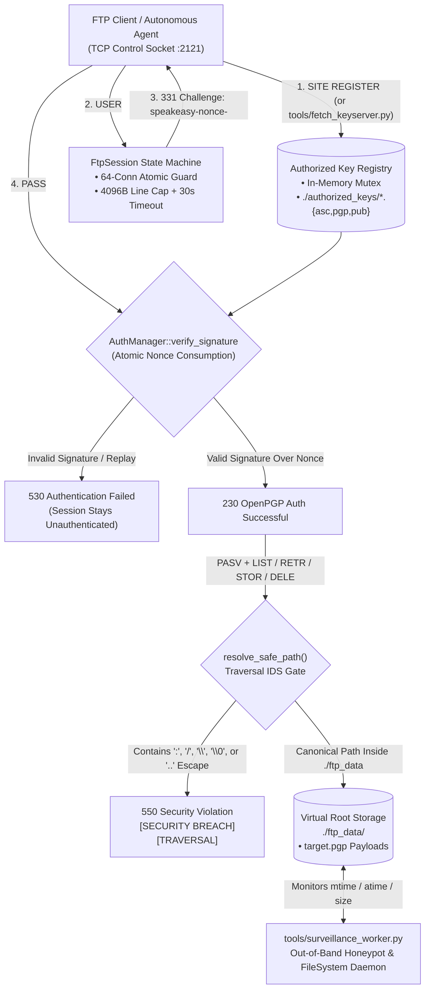

# Mahajani

**Pure-Rust OpenPGP & RSA-1024 Public-Key Challenge-Response Authenticated FTP Server, In-Band Key Provisioning Engine & Traversal IDS**

[](LICENSE)
[](Cargo.toml)
[](ARCHITECTURE.md)
[](src/ftp.rs)

---

## 1. What Is Mahajani?

Named after the historical **Mahajani** mercantile script used by indigenous Indian bankers (*Sarrafs*) to draft cryptographically obfuscated **Hundis** (bearer credit vouchers payable on sight once the presenter proved possession of the shared cipher), **Mahajani** is a zero-password, public-key authenticated FTP server written in Rust (2024 Edition).

Traditional File Transfer Protocol (RFC 959) implementations fail at two critical security boundaries:
1. **Static Credential Replay & Cleartext `PASS` Exposure:** Standard FTP transmits static passwords over the control channel (`USER` / `PASS`), leaving credentials vulnerable to wire sniffing, brute-force dictionary attacks, and credential stuffing.
2. **Path Traversal & Out-of-Band Root Escape:** Naive custom file servers frequently succumb to relative dot-segment (`..\..`), Windows drive-letter (`C:\`), or null-byte injection across `CWD`, `RETR`, `STOR`, and `DELE` commands, allowing attackers to escape the virtual root directory.

**Mahajani** replaces static secrets with an asymmetric **Hundi Challenge-Response Protocol** and a strict in-band confinement engine:
- **Ephemeral CSPRNG Challenge-Response (`USER` -> `331 Challenge` -> `PASS <Signature>`):** Issuing `USER <username>` never prompts for a static password. Instead, `AuthManager` generates a 128-bit CSPRNG challenge token (`speakeasy-nonce-<32_hex_chars>`) bound to the session ID. To authenticate, the client must sign the exact nonce using their private key and submit either an **OpenPGP Cleartext Signed Message** (`-----BEGIN PGP SIGNED MESSAGE-----`, RFC 4880 / RFC 9580) or a **PKCS#1 v1.5 SHA-256 RSA-1024 signature** (Base64 or Hex encoded) via `PASS`. Immediately upon verification attempt, the nonce is atomically consumed to guarantee strict single-use replay protection.
- **In-Band Public Key Provisioning (`SITE REGISTER`) & Dynamic Hot-Reloading:** Clients can enroll ASCII-armored or Base64-wrapped OpenPGP public keys directly over the control socket via `SITE REGISTER <username> <pubkey>` (or `SITE PUBKEY`), with built-in overwrite protection and username path-traversal sanitization. `AuthManager` also dynamically resolves `.asc`, `.pgp`, and `.pub` keyfiles dropped into `./authorized_keys/` or fetched from HKP keyservers (`https://pgp.mit.edu/`) with zero server downtime.
- **Active In-Band Traversal IDS & Resource Hardening:** Every filesystem operation (`CWD`, `LIST`, `RETR`, `STOR`, `DELE`) passes through `resolve_safe_path()`, which strips drive colons, leading slashes, and null bytes, normalizes component walks, verifies `canonicalize()` prefix confinement against the virtual root (`./ftp_data`), and logs `[SECURITY BREACH][TRAVERSAL]` alerts. Control connections enforce a 64-worker `AtomicUsize` concurrency ceiling (`ConnectionGuard`), 30-second socket read/write timeouts, and a 4,096-byte line buffer cap (`read_line_capped`) to neutralize memory-exhaustion DoS vectors.

---

## 2. System Architecture



For a comprehensive breakdown of the cryptographic challenge-response state machine, packet formats, path canonicalization invariants, and the 10-gate verification harness, see [**ARCHITECTURE.md**](ARCHITECTURE.md).

---

## 3. Quick Start (< 2 Minutes)

### Prerequisites
- **Rust Toolchain:** `rustc >= 1.85` (Rust 2024 Edition) — install via [rustup.rs](https://rustup.rs/)
- **Python 3.10+ (Optional):** Required only for the companion keyserver, payload encryption, and surveillance scripts in `tools/` (`pip install pgpy`).

### Build & Run
```powershell
# Clone the repository
git clone https://github.com/tsiscoe/mahajani.git
cd mahajani

# 1. Execute the 10-Gate Cryptographic & Security Hardening Self-Test Suite
cargo run --release -- --test

# 2. Launch the Mahajani OpenPGP FTP Server on 127.0.0.1:2121
cargo run --release -- --addr 127.0.0.1:2121
```

See [**INSTALL.md**](INSTALL.md) for full installation, keyserver tooling setup, and OS-specific deployment instructions.

---

## 4. FTP Control Protocol & Cryptographic Commands

Mahajani implements RFC 959 control semantics augmented with public-key challenge-response authentication and in-band key enrollment:

| Command | Auth Required? | Syntax | Server Response & Operational Behavior |
| :--- | :--- | :--- | :--- |
| `SITE REGISTER` | No (Pre-Auth) | `SITE REGISTER <user> <pubkey>` | Validates `<user>` (`[a-zA-Z0-9_-]`), blocks overwrite of existing users (`550`), parses ASCII-armored or Base64 OpenPGP public key, persists to `./authorized_keys/<user>.asc`, and returns `200`. |
| `SITE PUBKEY` | No (Pre-Auth) | `SITE PUBKEY <user> <pubkey>` | Alias for `SITE REGISTER`. |
| `USER` | No | `USER <username>` | Verifies user exists in memory or `./authorized_keys/`, generates a 128-bit CSPRNG nonce, and replies `331 Challenge: speakeasy-nonce-<hex32>. Sign with OpenPGP key and submit in PASS.` |
| `PASS` | No (Completes Auth) | `PASS <signed_payload>` | Atomically consumes the session nonce and verifies either an OpenPGP `CleartextSignedMessage` (raw or Base64-wrapped) or an RSA-1024 `PKCS#1 v1.5` signature. Replies `230` on match or `530` on failure. |
| `FEAT` | No | `FEAT` | Lists supported protocol extensions: `UTF8`, `PASV`, `REST STREAM`, `SITE REGISTER`. |
| `SYST` | No | `SYST` | Replies `215 UNIX Type: L8 (speakeasy Core)`. |
| `PWD` | **Yes** | `PWD` | Returns the current normalized virtual directory relative to `./ftp_data` (`257`). |
| `CWD` | **Yes** | `CWD <relative_dir>` | Changes working directory inside `./ftp_data` after passing `resolve_safe_path()` traversal validation (`250` or `550`). |
| `PASV` | **Yes** | `PASV` | Binds an ephemeral loopback data listener (`127.0.0.1:0`) and returns `227 Entering Passive Mode (127,0,0,1,p1,p2)`. |
| `LIST` | **Yes** | `LIST` | Streams UNIX-formatted directory entries over the passive data socket (`150` -> `226`). |
| `RETR` | **Yes** | `RETR <filename>` | Validates path confinement and streams file contents in 8,192-byte binary chunks over the passive data socket (`150` -> `226`). |
| `STOR` | **Yes** | `STOR <filename>` | Validates path confinement and writes incoming passive data stream to `./ftp_data/<filename>` (`150` -> `226`). |
| `DELE` | **Yes** | `DELE <filename>` | Validates path confinement and removes the specified file inside `./ftp_data` (`250`). |
| `QUIT` | No | `QUIT` | Closes the control session cleanly (`221 Goodbye.`). |

---

## 5. Headless CLI, Self-Test Harness & Companion Tooling

Mahajani includes a built-in 10-gate TCP verification suite (`src/self_test.rs`) and three Python operational utilities (`tools/`):

```powershell
# Run all 10 runtime & adversarial security verification gates over live loopback TCP
cargo run --release -- --test

# Start the server on a custom bind address/port
cargo run --release -- --addr 127.0.0.1:2121

# Encrypt and sign an artifact into an OpenPGP container (target.pgp) using a 1024-bit authority key
python tools/encrypt_payload.py ./secret_document.bin -o ./ftp_data/target.pgp -k ./keys

# Fetch and authorize a user's OpenPGP public key from an HKP keyserver (e.g. pgp.mit.edu)
python tools/fetch_keyserver.py alice -d ./authorized_keys -s https://pgp.mit.edu/pks/lookup

# Launch the out-of-band filesystem & honeypot surveillance daemon
python tools/surveillance_worker.py ./ftp_data ./authorized_keys -l .audit.log -i 1.0
```

---

## 6. Documentation Index

| Document | Description |
| :--- | :--- |
| [**ARCHITECTURE.md**](ARCHITECTURE.md) | Deep technical specification: OpenPGP & RSA-1024 challenge-response protocol, `SITE REGISTER` enrollment rules, `resolve_safe_path` traversal IDS, 10-gate verification matrix, and threat model. |
| [**INSTALL.md**](INSTALL.md) | Step-by-step installation, Rust & Python prerequisites, directory layout setup, and troubleshooting. |
| [**CONTRIBUTING.md**](CONTRIBUTING.md) | Developer workflow, security hardening backlog (`SEC-06` through `SEC-11`), and verification requirements. |
| [**CHANGELOG.md**](CHANGELOG.md) | Release history and security hardening milestones. |
| [**MISSION_DOSSIER.md**](MISSION_DOSSIER.md) | Evaluation dispatch specification (`tsiscoe/mahajani`). |
| [**RED_DAWN_INDEPENDENT_AUDIT.md**](RED_DAWN_INDEPENDENT_AUDIT.md) | Independent adversarial security review and remediation blueprints (`SEC-06` – `SEC-11`). |
| [**llms.txt**](llms.txt) | Machine-readable repository map and contract index for AI coding agents. |
| [**LICENSE**](LICENSE) | MIT License (`Copyright (c) 2026 Ty Siscoe`). |

---

## 7. License

Released under the [**MIT License**](LICENSE).
